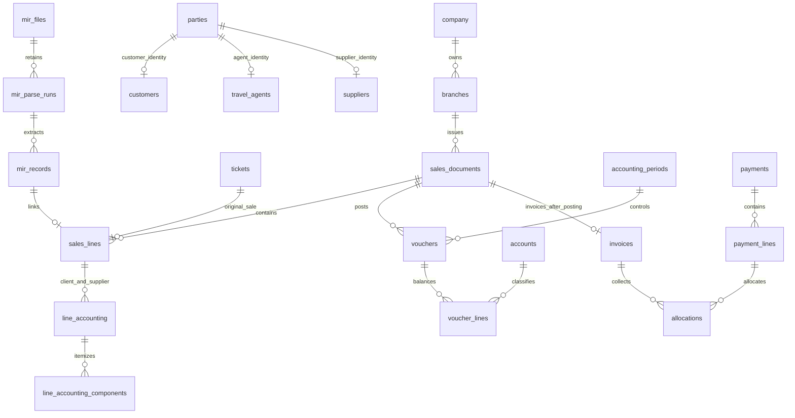

# Legacy Phase 2: PostgreSQL foundation

> **Not used by the current MySQL runtime.** The SQL migrations and integrity tests below are PostgreSQL-specific. The MySQL backend intentionally refuses to execute these files. For the current local MySQL connection/bootstrap instructions, see [local MySQL setup](./mysql-local-setup.md). The MySQL schema and equivalent financial integrity controls still need to be ported and verified before the application can become database-ready.

The Go backend now reads the existing cloud connection file, enforces certificate-verified TLS, reports database/schema readiness and includes three versioned migrations. The schema is isolated in `finbook`; existing `public.employees` is neither imported nor modified. `finbook.employees` is an independent ERP master for later setup.

## Apply and verify from Windows

```powershell
cd 'D:\Projects\Volta-Tours-Finance'
powershell -NoProfile -ExecutionPolicy Bypass -File .\scripts\complete-phase2.ps1
```

This command runs local Go tests and static checks, validates the complete SQL in an isolated `finbook_test_*` schema in the cloud database, rolls back all test fixtures/schema, applies pending migrations to `finbook` in one transaction, and verifies the migration history. Integrity tests run **before** the real schema is migrated. A failed test stops the process. The schema owner needs CREATE SCHEMA permission.

The command is idempotent: another run checks existing migration checksums and applies only new versions. An unknown/nonempty unmanaged `finbook` schema or modified migration history is rejected. Concurrent migration runners serialize with an advisory transaction lock. No automatic down/drop command is provided for financial data; corrections use new forward migrations.

Inspect only, without schema changes:

```powershell
powershell -NoProfile -ExecutionPolicy Bypass -File .\scripts\complete-phase2.ps1 -StatusOnly
```

Then run the application using the existing launch commands:

```powershell
powershell -NoProfile -ExecutionPolicy Bypass -File .\scripts\start-api.ps1
# In a second PowerShell terminal:
cd 'D:\Projects\Volta-Tours-Finance\frontend'
npm.cmd run dev
```

Open `http://127.0.0.1:5173`. The footer now reports the actual API database state. Connecting the DB never enables unauthenticated financial writes. Masters, login/session enforcement, sales saves and posting services remain in their later phases.

## Connection configuration

Server precedence is `DATABASE_URL`, then the file specified by `DATABASE_CREDENTIAL_FILE`, then the sibling `D:\Projects\DB\postgresql.txt` file under the normal Windows project layout. The file may contain the URL directly or `DATABASE_URL=...`, optionally quoted. `FINBOOK_ROOT` identifies the repository root; the supplied scripts set it. No password is copied into source, browser state, logs or command-line arguments. `.env.example` documents environment variables but is not an automatic dotenv loader.

All connections enforce `sslmode=verify-full`, minimum TLS 1.2, and no plaintext fallback. The backend currently uses bounded, short-lived connections for metadata probes; a CRUD connection pool will be added with Phase 3. The migration and access-check helpers are separate explicit commands. API startup never migrates the database.

| Endpoint | Behavior |
| --- | --- |
| `/healthz` | Process health, independent of the database |
| `/readyz` | HTTP 200 only when cloud connection and migration history are current; otherwise 503 |
| `/api/v1/status` | Phase, connection state, schema readiness, migration counts and unavailable feature flags; no credentials |

Connection states include `not_configured`, `unavailable`, `connected_schema_pending`, `schema_incompatible` and `connected`. A connection failure is never shown as a successful connection.

## Schema groups

| Group | Foundation |
| --- | --- |
| Organization and masters | One company, branches, staff, parties with separate customer/agent/supplier identities, airlines, geography, currencies/rates, projects, services, cost centres |
| Access and workflow | Users/password hashes, hashed sessions, roles, module/screen/action permissions, approval rules/requests/append-only decisions |
| Accounting configuration | Chart of accounts, encrypted bank identifiers plus masked suffix, voucher types, numbering, financial years and nonoverlapping periods |
| Configurable finance rules | Versioned GST/TDS/tax applicability and commercial/refund rules; no rates or thresholds seeded; finance verification required for activation |
| Common sales | One sales document/line model for International, Domestic and Miscellaneous, canonical ticket identity and passenger-linked segments |
| Two-sided ticket accounts | Separate client/supplier records, component amounts, source tags and currency-aware margin view |
| MIR staging | Immutable raw bytes/hash/lines, versioned parse runs, passenger records, extracted fields, correction reasons and append-only value events |
| Ledger and settlement | Multi-line vouchers, unique posting idempotency keys/payload hashes, official invoices, cash/bank receipts/payments, allocations and reversal links |
| Operations | Cancellation/refund/reissue/exchange/void/ADM/ACM/no-show events, statement imports, reconciliation match/unmatch events and attachments |
| Audit | Mutation history, DB principal, optional application actor/request context, old/new values and reason; secrets are redacted |



## Database controls

- One company is enforced without seeding its name, state, GST registration or accounting conventions. There are no seeded users, roles, tax rates, approval limits, accounts, currencies, periods or financial amounts.
- Ticket numbers have a canonical alphanumeric identity; alternate punctuation cannot create another original sale. PNRs remain nonunique because multiple passengers can share a booking. Exchange/refund/adjustment events link to originals instead of creating duplicate originals.
- Monetary domains use exact numeric values and reject more than six decimals rather than silently rounding. Individual currencies define accepted posting precision. FX rates are positive and retain up to twelve decimals. No tax applicability or financial amount is inferred.
- Voucher posting requires at least two lines, exact debit/credit equality, active/postable accounts, an active voucher type, company base currency and an open matching period/year. Parent-row locks protect posting from concurrent line changes.
- Posted voucher amounts and source rows cannot be edited or physically deleted. A reversal must be posted, linked, reasoned and exactly offset account/party/cost-centre balances. Posted originals remain in the ledger along with their reversing entries.
- Sales, payment and after-sales posting requires linked posted vouchers. Client/supplier accounting must be complete before a sales document posts. Official invoices require a posted sale. Full approval/duplicate/idempotency-return behavior still belongs to the later application posting engine.
- Allocations require posted payments/receipts, matching target currency and remaining balances. Allocation reversals are appended and must exactly match their originals. Configurable foreign-currency/refund netting is not guessed or enabled in this foundation.
- MIR bytes, extracted fields, line evidence, field corrections, decisions, value histories and financial allocation events have immutability controls. MIR retries append parse runs while preserving originals.
- Business/configuration mutations are audited. Audit log UPDATE/DELETE/TRUNCATE are rejected. Application actor/request/reason context will be supplied by the authenticated services; direct migration/admin activity retains the database session principal. Database owners with DDL privileges remain trusted administrators.
- Audits redact password/token hashes, encrypted bank/passport fields and raw byte blobs. Bank/passport values must be encrypted by later application services before persistence; merely storing a column named ciphertext is not encryption implementation.

`posted_entries`, `trial_balance` and `statement_balances` exclude drafts. `sales_line_margin` keeps currencies separate. `customer_outstanding` starts from posted sales and allocations. These are reporting foundations, not completed Phase 7 P&L/balance-sheet/refund-netting reports.

## Validation and current limit

Local Go tests cover credential handling, mandatory verified TLS, migration checksum/history drift and readiness. The opt-in PostgreSQL integration test covers SQL creation, unequal/closed-period posting rejection, duplicate idempotency keys, posted immutability, matching reversals, canonical ticket duplicates, tax verification, exact precision and audit redaction/immutability. All fixtures use a newly generated test schema and are rolled back.

Frontend tests cover connected/pending/unavailable database states while financial write controls remain disabled, alongside the existing login/navigation/manual/MIR/payment regression suite.

**Cloud application is not yet verified from the agent sandbox.** The existing credential file authenticates successfully from the user's PowerShell session, but outbound DB connections from the sandbox remain denied. Local compilation and unit/UI tests do not constitute PostgreSQL SQL execution. The explicit completion script above must succeed in a network-enabled session before Phase 2 can be described as applied and fully verified in the cloud.
